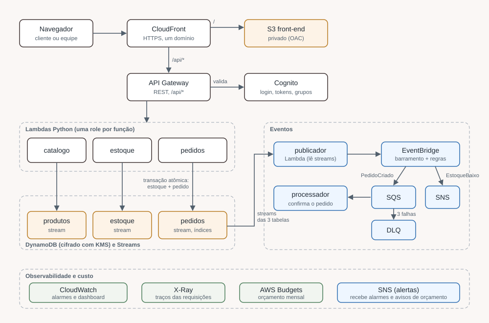

# Vitrine Modas: e-commerce de moda serverless na AWS

Projeto de estudo (portfólio de arquitetura cloud): um e-commerce de moda fictício, com pico sazonal de tráfego (Black Friday), catálogo que muda e estoque que precisa ficar consistente. Região `sa-east-1`, infraestrutura como código em Terraform com módulos e funções Lambda em Python.

> **Status:** projeto de estudo. O código foi validado com `terraform fmt`, `validate`, `plan`, `tflint`, `checkov` e testes Python. **Nada foi implantado na AWS** (`terraform apply` nunca é executado), então este repositório não afirma nenhum número de latência, disponibilidade, custo real ou volume de usuários.



## O problema e a resposta de arquitetura

| Problema | Decisão |
|---|---|
| Pico de tráfego | API Gateway e Lambda escalam sozinhos; CloudFront serve o site; SQS absorve a confirmação de pedidos |
| Estoque consistente | Pedido e baixa de estoque na mesma transação do DynamoDB, com condição `quantidade >= pedido` |
| Catálogo que muda | Streams do DynamoDB viram eventos no EventBridge; consumidores novos entram sem mexer no produtor |
| Segurança | Cognito + authorizer na API, uma role de mínimo privilégio por Lambda, KMS própria, bucket privado com OAC, TLS obrigatório |
| Visibilidade | X-Ray, alarmes e dashboard no CloudWatch, orçamento no AWS Budgets |

## O que foi construído (módulos Terraform)

| Módulo | O que cria |
|---|---|
| `kms` | 3 chaves (DynamoDB, S3, mensageria) com key policy separando administrar de usar |
| `storage` | Bucket do front-end e bucket de logs (bloqueio público, TLS obrigatório, ciclo de vida) |
| `dynamodb` | Tabelas `produtos`, `estoque` e `pedidos` (sob demanda, KMS, PITR, Streams, 2 índices) |
| `cognito` | User pool, app client público e grupos `clientes` e `admin` |
| `lambda_function` | Função Python com role própria, log group e X-Ray (reutilizado 5 vezes) |
| `api` | API Gateway REST com 8 rotas, authorizer do Cognito e limite de requisições |
| `eventos` | Barramento EventBridge, fila SQS com DLQ, tópico SNS e 2 regras |
| `cloudfront` | Distribuição com OAC para o S3 e rota `/api/*` para a API |
| `observabilidade` | 7 alarmes, dashboard, orçamento e regra de amostragem do X-Ray |

## Estrutura

```
terraform/            módulos e arquivos da raiz (um arquivo por fase)
src/lambdas/          código Python das 5 funções
tests/                testes das funções (pytest + moto)
frontend/index.html   página de demonstração
docs/                 ARCHITECTURE, DECISIONS, COST-ANALYSIS e cadernos por fase
```

## Como validar (sem credenciais para o código, sem apply)

```bash
# Testes das Lambdas (simulam o DynamoDB na memória)
python -m venv .venv && source .venv/bin/activate    # Git Bash no Windows: .venv/Scripts/activate
pip install -r requirements-dev.txt
pytest -q tests

# Terraform
cd terraform
terraform fmt -recursive -check
terraform init -backend=false
terraform validate
terraform plan        # lê a conta AWS (precisa de credenciais), mas não cria nada
```

O CI do GitHub roda `fmt`, `validate`, `tflint`, `checkov` e `pytest` a cada Pull Request, sem credenciais da AWS e sem `plan`.

## Documentação

- [ARCHITECTURE.md](docs/ARCHITECTURE.md): componentes, fluxos e camadas de segurança.
- [DECISIONS.md](docs/DECISIONS.md): por que usei, por que não usei e o que abri mão, em cada fase.
- [COST-ANALYSIS.md](docs/COST-ANALYSIS.md): método para estimar custo, com hipóteses explícitas.

## Limites conhecidos

- O `plan` e os testes não provam permissões IAM, políticas de chave KMS nem a integração real entre serviços; isso só um `apply` mostraria.
- Sem domínio próprio, WAF, logs de acesso do CloudFront e pagamento/entrega reais (ver DECISIONS).
- Valores de limite (alarmes, throttling, orçamento) são de estudo, não medidos.
