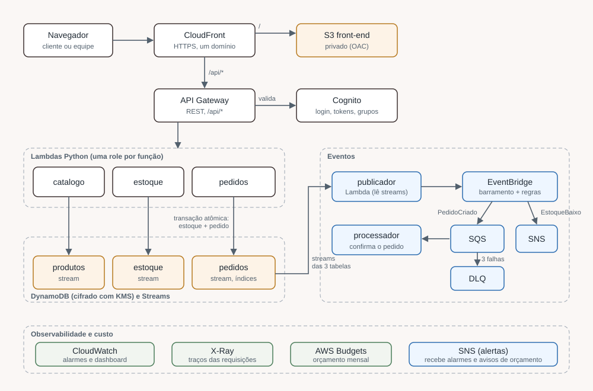
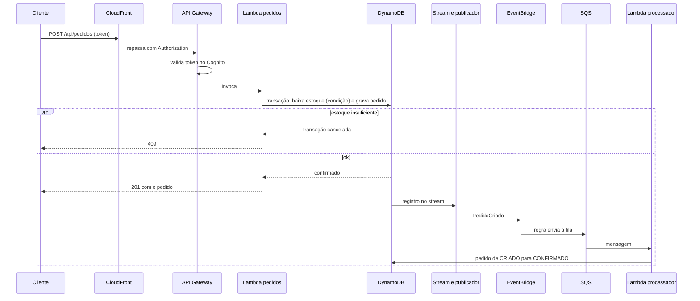

# Arquitetura — Vitrine Modas

Projeto de estudo, não implantado. Este documento descreve o desenho e o que cada parte faz; o porquê de cada escolha está em [DECISIONS.md](DECISIONS.md).

## Visão geral
Um único domínio do CloudFront serve o site estático (S3 privado) e a API (`/api/*` no API Gateway), o que dispensa CORS. A API valida o token do Cognito e chama três funções Lambda em Python que lêem e escrevem no DynamoDB. As mudanças nas tabelas viram eventos no EventBridge, que acionam uma fila de processamento de pedidos e um tópico de alertas.

## Componentes

| Camada | Serviço | Papel |
|---|---|---|
| Borda | CloudFront | HTTPS, cache do site, rota `/api/*` sem cache |
| Site | S3 (privado, OAC) | Arquivos estáticos do front-end |
| API | API Gateway REST | 8 rotas, authorizer Cognito, limite por rota |
| Identidade | Cognito | Cadastro, login, tokens, grupos `clientes` e `admin` |
| Lógica | Lambda (Python 3.12, arm64) | `catalogo`, `estoque`, `pedidos`, `publicador`, `processador` |
| Dados | DynamoDB | `produtos`, `estoque`, `pedidos`, sob demanda, KMS, PITR |
| Eventos | EventBridge, SQS, SNS | Desacoplamento, fila com DLQ, alertas |
| Chaves | KMS | Chaves separadas para DynamoDB, S3 e mensageria |
| Observabilidade | CloudWatch, X-Ray, Budgets | Alarmes, dashboard, traços, orçamento |

## Fluxo 1: compra

## Fluxo 2: estoque baixo
O `publicador` lê o stream de `estoque` e, quando a quantidade **cruza** o limite (padrão 3), publica `EstoqueBaixo`. Uma regra do EventBridge envia o evento ao tópico SNS de alertas. Quem assinar o tópico (e-mail, opcional) recebe o aviso.

## Fluxo 3: login
O front-end autentica no Cognito (fluxo SRP, sem Hosted UI) e envia o token no cabeçalho `Authorization`. O API Gateway valida o token antes de chamar a Lambda; a Lambda confere o grupo (`admin`) e o dono do recurso.

## Camadas de segurança
1. HTTPS obrigatório e cabeçalhos de segurança no CloudFront.
2. Bucket privado: só a distribuição lê (OAC), e TLS obrigatório na policy.
3. Token do Cognito validado no API Gateway; grupo e dono conferidos na Lambda.
4. Uma role por Lambda, com ARNs exatos de tabelas e índices.
5. Chaves KMS separadas, com key policy que só aceita uso via o serviço certo.
6. Limite de requisições por rota; erros 5xx, falhas de função e DLQ com alarme.

## O que o desenho não cobre
Sem domínio próprio, WAF, pagamento, nota fiscal ou entrega, e sem destino de falha nos streams (um lote que falha 3 vezes é descartado). Entrega de eventos é "pelo menos uma vez": os consumidores são idempotentes. Detalhes e justificativas em DECISIONS.md.

## O que foi e o que não foi provado
Validado: formatação, sintaxe e coerência do Terraform (`validate`, `plan`), regras de segurança estáticas (`checkov`, `tflint`) e a lógica das funções (testes com DynamoDB simulado). **Não provado:** permissões IAM e políticas KMS em funcionamento, integração real entre serviços, desempenho e custo. Para isso seria preciso um `apply`, que este projeto não faz.
